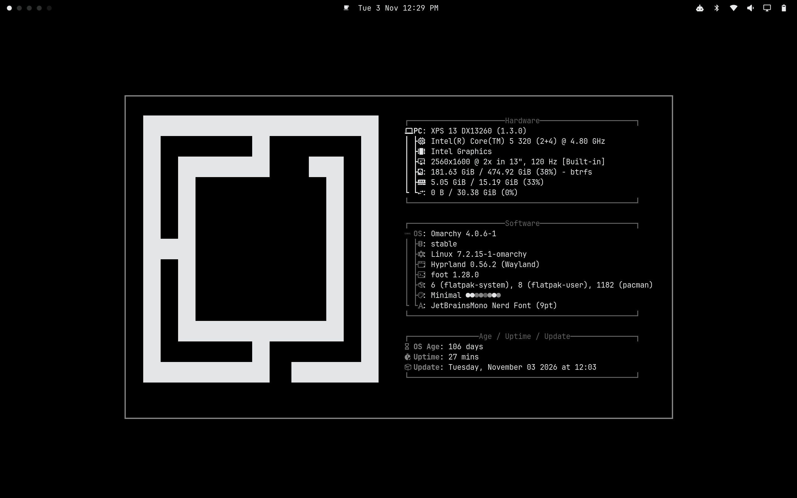

# Omarchy Minimal

A greyscale theme for Omarchy. Black backgrounds, grey accents, near-white text,
opaque terminals, and a pure black 4K wallpaper.



## Install

```bash
mkdir -p ~/Work
git clone https://github.com/maxart/omarchy-minimal.git ~/Work/omarchy-minimal
~/Work/omarchy-minimal/install.sh --apply
```

Keep the cloned folder in place. Reopen GTK apps after applying.

## Select

Choose **Minimal** in the theme picker, or run:

```bash
omarchy theme set minimal
```

## Unlock

A grey Omarchy logo on pure black. Select **Minimal** under **Appearance → Unlock**.


## Uninstall

Select another theme, then run:

```bash
~/Work/omarchy-minimal/install.sh --uninstall
```

## More

Explore [Simple Workspaces](https://github.com/maxart/simple-workspaces), another project of mine.

## License

[MIT](LICENSE).
